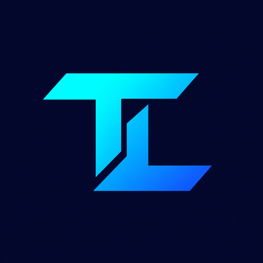

  

<h1 align="center">TLMSsoft</h1>

<strong>Software that keeps business connected.</strong>

Business platforms · B2B commerce · Mobile operations · Integrations

  <a href="https://b2b.tlmssoft.com">B2B Portal</a>
  &nbsp;·&nbsp;
  <a href="https://torg.tlmssoft.com">Torg Workspace</a>
  &nbsp;·&nbsp;
  <a href="https://github.com/tlmssoft/.github/blob/main/profile/README.uk.md">Українською</a>

---

### Built around the way your business works

We develop connected software for sales teams, suppliers and business customers. Our focus is practical: clear workflows, dependable integrations and products that work on desktop and mobile.

| Business platforms | Digital commerce | Mobile operations |
| --- | --- | --- |
| Team management, routes, visits and operational reporting. | B2B catalogs, ordering, customer service and delivery visibility. | Field workflows, photos, location data and synchronization. |

### One connected ecosystem

**Torg** brings sales teams, customer locations and field activity into one workspace. It connects operational workflows with external accounting systems through explicit APIs.

**B2B Portal** gives business customers a direct way to browse an assortment, place orders and work with their supplier. It connects to Torg while keeping the customer experience focused and accessible.

**Mobile** supports sales representatives in the field, with workflows designed around visits, orders and synchronization.

### Engineering for the long run

- **Clear boundaries.** Independent applications with explicit integration contracts.
- **Consistent experiences.** React, Next.js and React Native across web and mobile.
- **Dependable foundations.** Python, FastAPI, PostgreSQL and versioned migrations.
- **Repeatable delivery.** Automated checks, Docker-based deployments and verified recovery procedures.

---

<strong>Thoughtful engineering. Useful products. Connected business.</strong>

Product source repositories are private. This profile introduces our work and publishes our brand assets.

